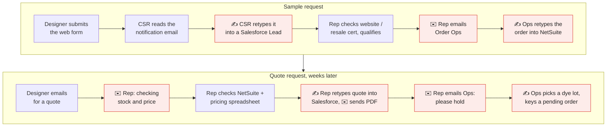
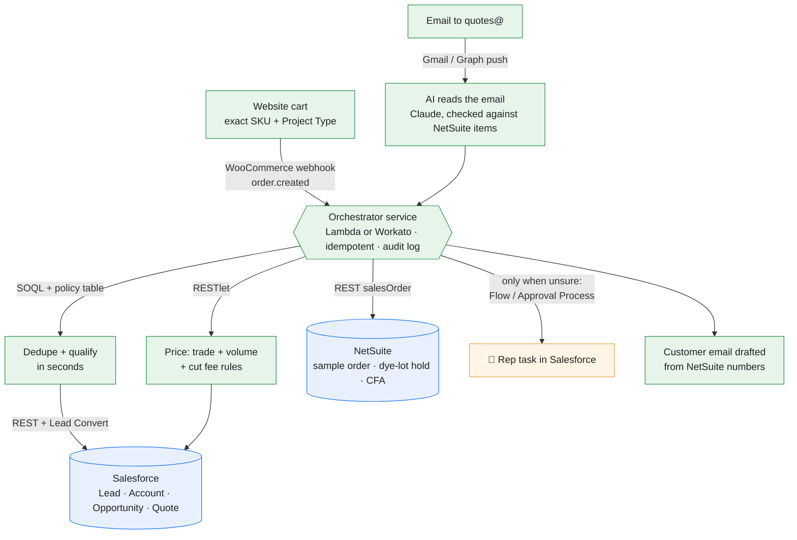

# Perennials: Sample-to-Quote PoC

Today the sample-to-quote journey crosses three systems that don't talk to each other: the website, the CRM (Salesforce) and the ERP (NetSuite). People retype the same information from one into the next and email customers back and forth. This PoC puts one integration layer between them. Every request goes through all six stages (lead, qualification, sample order + opportunity, quote request, price quote, inventory reservation) with no retyping, and a person steps in only when a judgment call is needed.

## Old flow vs new flow

**Today: people carry the data between systems.**



**New: one integration layer moves the data; a person steps in only for judgment.**



🔴 retyping or an email between people · 🟢 automated · 🟠 a person decides · 🔵 system of record

### What changed, and how it's built

| # | For the business | For engineering: where it runs |
|---|---|---|
| 1 | **No retyping web requests into the CRM.** A sample order lands as a Lead with the exact fabric already attached. | WooCommerce `order.created` webhook → orchestrator → Salesforce REST `POST /Lead` + Lead Convert API |
| 2 | **No duplicate customers.** A second email address at the same firm is recognised as the same person. | SOQL on email, then domain + name; Salesforce Duplicate Rules as a backstop |
| 3 | **Qualification in seconds.** Known trade accounts and clear cases are handled; reps see only the gray zone (e.g. "designer" on a Gmail address). | Policy table in the orchestrator; `Lead.Status` + `Qualification_Reason__c`; review Task assigned by Flow |
| 4 | **Sample orders reach NetSuite on their own,** linked to the Salesforce opportunity. | NetSuite REST `salesOrder` (Sample form, $0 price level); customer `externalId` = Salesforce Account Id |
| 5 | **Quote emails are read for the rep.** "80 yds of the navy stripe" becomes SKU + quantity. Colors are settled from the catalog and the customer's own samples before anyone is asked. | Gmail push / Microsoft Graph subscription on quotes@; Claude with structured outputs (email only), validated against the NetSuite item list; rules cross-check |
| 6 | **No "let me check stock and price" replies.** Price and dye-lot availability come back in the same step. | NetSuite RESTlet (SuiteScript) for trade / volume / cut-fee rules; inventory by lot |
| 7 | **Quote attached to the opportunity, customer email drafted.** Numbers come only from NetSuite, never from the AI. | Salesforce `Quote` + `QuoteLineItem`, PDF via `ContentVersion`; email template sent from Salesforce |
| 8 | **Fabric held from one dye lot,** released automatically after 14 days. A split across lots asks for a CFA (cutting for approval). | NetSuite sales order with lot-level inventory detail; scheduled SuiteScript releases expired holds; CFA sales order form |
| 9 | **Revisions don't double-hold.** "Make that 90 yds" releases the old hold and re-quotes as v2. | Quote versioning in Salesforce; close old NetSuite SO lines before re-allocating |
| 10 | **People only where judgment matters:** big quotes, split lots, shortages, backorders, gray-zone leads. | Salesforce Task / Approval Process (e.g. over $20k); approve runs the held action |
| 11 | **Every step is traceable.** | Audit log per request, inbound message / order id as the idempotency key; retries + dead-letter queue |

## What's in this repo

| Folder | For | What's inside |
|---|---|---|
| [`s2q/`](s2q/) | Both | **The shared core:** the workflow, intake (cart + email), dedupe, qualification, pricing, email templates, and the CRM/ERP adapter interface with in-memory mocks. Tested; production runs it unchanged. |
| [`demo/`](demo/) | Reviewers | The walkthrough app (storefront, CRM, ERP, Old vs New, ops console), its data (the workbook + 6 added edge cases) and a filming guide |
| [`production-handoff/`](production-handoff/) | Engineering | The system-by-system build list ([README](production-handoff/README.md)) plus **skeleton building blocks**: WooCommerce plugin and webhook, the AWS integration service (handlers, worker, Salesforce/NetSuite adapters, schema, SAM template), Salesforce Apex and metadata, NetSuite SuiteScripts, Gmail watch setup |
| [`docs/`](docs/) | Reviewers | Design note and AI usage notes |
| [`case-study-prompt/`](case-study-prompt/) | | Bertram's original brief and workbook, unchanged |

In the demo's seeded data, Dana Ruiz's journey (2 sample requests, a quote, a revision) takes about **35 manual steps, 84 retyped fields and 8 internal emails** today, versus **2 rep approvals** with the workflow. The manual-side numbers are illustrative estimates (`demo/baseline.py`), not measurements.

## Run it (under 5 minutes)

Requires Python 3.10+.

```bash
python -m venv .venv && source .venv/bin/activate      # Windows: .venv\Scripts\activate
pip install -r requirements.txt

streamlit run demo/app.py     # demo at http://localhost:8501/
python -m s2q.cli -v          # or headless: every workbook request, stage by stage, with email drafts
pytest -q                     # 40 tests
```

**Optional: use Claude for email extraction.** Run `export ANTHROPIC_API_KEY=sk-...` before starting. If the key is in a `.env` one folder up, load it with `set -a; source ../.env; set +a`. Set `S2Q_MODEL` to override the model (default `claude-opus-5-5`, low effort). Without a key, the deterministic rules extractor is used and everything works the same. With a key, Claude reads each email and the rules run as a cross-check; if they disagree, the request goes to review. Website carts are structured, so they never go to the LLM.

## The demo

One app, five pages, sharing one in-memory workflow. It starts **seeded**: the 27 workbook requests (21 original + 6 edge cases we added) are already processed, so the CRM and ERP have history.

| Page | What it is |
|---|---|
| 🛍 **Website** | Mock storefront modelled on the real site's flow (not its branding): product page with colorways, **Add Sample** + Project Type, **Request A Quote** (Length in Yards / Feet / Meters, Date Needed, CFA, Project Name), cart, guest checkout. Checkout runs the workflow live. |
| ☁️ **CRM** | Salesforce-style: the **quotes@ inbox** (send an email as a customer), leads, accounts, **opportunity record pages** with sample orders and quotes, and the rep's task queue. |
| 🏭 **ERP** | NetSuite-style: inventory by dye lot, sales orders (samples, holds, CFA cuttings), customers keyed to CRM accounts. |
| ⚖️ **Old vs New** | Pick a customer journey: every automated action next to the manual step it replaces, with totals. |
| 🛠 **Ops console** | Each request's full story, the review queue, and the integration log (every call with the real API it maps to). |

**Demo script** (also in the app's sidebar):
1. **Website**: open *Tidal Herringbone*, Add Sample, check out as **Dana Ruiz**.
2. **CRM → Opportunities → Ruiz Interiors**: the new sample order is on her existing opportunity. No duplicate lead.
3. **ERP → Sales orders**: the sample order, keyed to her CRM account.
4. **CRM → Inbox**: send *Dana: 30 yds of the herringbone*. It's priced, held and sent with no one touching it.
5. **ERP → Inventory**: lot L-2403 now shows 30 yd reserved.
6. **Old vs New → Ruiz Interiors**.
7. Edge cases: *the canvas* (settled by sample history), *the linen* (one drafted question), a 90 ft quote line with CFA requested on the website.

## Interesting rows

| Request | What happens | Why |
|---|---|---|
| WEB-003 | Dana Ruiz from `d.ruiz@` is matched to the same contact, and the email is added as an alternate | Same domain + same name; prevents a duplicate lead/opportunity |
| WEB-005 | Disqualified, no samples or price list, account owner notified | CRM account is *Do Not Sell* (competitor) |
| WEB-007 | Spam is filtered and nothing is written to CRM | Keeps the CRM clean |
| WEB-008 | Qualified, but Sunset Ikat is excluded from samples; the email offers the 22 yd remaining | Discontinued: no new samples |
| WEB-002, WEB-009 | Non-trade nurture email, no free samples | Consumer / student |
| WEB-012 | Goes to review with a drafted email asking for a resale certificate or business website; the rep can approve, send it, or reject | Says "designer" but uses a personal Gmail address |
| WEB-013 | Goes to review with a drafted "which 10 first?" email listing all 14 | 14 SKUs in the cart, max 10 |
| EML-014 | Quote with 20% (trade + volume) on 80 yd stripe; held across **two dye lots** goes to review, needs a CFA from each lot | No single lot covers 80 yd |
| EML-015 | 12 m becomes 13.25 yd; "green velvet" is quoted as Velvet Plush Moss (the only green), named in the email, no confirmation hold; out of stock, so not reserved and goes to review | Unit conversion + unique color match + zero stock |
| EML-016 | $34.9k quote, 120 yd short on Canvas White, goes to manager review | Shortage + split lot + high value + need-by date |
| EML-017 | Clean quote with the $25 cut fee is **sent automatically** and held | No flags |
| EML-018 | Budgetary quote, no hold placed | Customer said pricing only |
| EML-019 | Backordered (ETA 11/15) vs. "ASAP": priced, not held, goes to review | Can't reserve what isn't there |
| EML-020 | Student is quoted list price + cut fee; becomes a consumer account | Non-trade pricing |
| EML-021 | **Revises** Q-0101 to v2: the old hold is released and a new hold placed (87 of 90 yd available) | Follow-up on the same job |
| *Rows we added (see "We extended the test data" below)* | | |
| WEB-014 | Website quote form: 90 **feet** becomes 30 yd, a hold on one dye lot, and a **CFA** cutting order from that lot; review only to confirm the date needed | The real site's Request A Quote fields |
| EML-022 | "sixty yards" in words. Rules can't read it, so they draft a question; Claude prices it, but the two disagree, so it goes to review | Shows what the AI adds, and the disagreement guard |
| EML-023 | "the linen" from Mara, who sampled both colors: one drafted question with stock per color. Her open linen quote is **not** superseded | Real color tie; also caught a bug (an ambiguous line used to trigger a revision and release the hold) |
| EML-024 | "price the plaid" with no quantity: one drafted question | Missing quantity |
| EML-025 | 30 yd of discontinued Sunset Ikat: quoted and held for the 22 yd that remain | Discontinued rule |
| EML-026 | Hannah (Gmail, trade check still open) asks for a price: joins the existing review with a trade-verification email | Caught a gap: Claude read her as a consumer and auto-sent a list-price quote |

## We extended the test data

The 21 requests Bertram provided all pass, but they don't exercise several cases the workflow has to handle, so we **added 6 rows to the workbook's Inbound Requests tab** (WEB-014, EML-022 to EML-026). Each is marked in a new **Notes** column and in the Read Me tab. The original file is unchanged in `case-study-prompt/` for comparison. The added rows found two real issues, both now fixed and tested: an ambiguous color could supersede an open quote and release its hold, and Claude's reading of a sender could skip an open trade review. Every row runs under both the rules and Claude; outcomes match except EML-022, where they are meant to differ.

## Layout

```
s2q/                        Shared core (tested; ships to production unchanged)
  workflow.py               Orchestrator: the six stages, review queue, approve / reject / ask
  extract.py                Website cart -> request (CartIntake); email -> request (Claude structured outputs, or rules)
  identity.py, qualify.py   Dedupe against the CRM; qualification policy table
  pricing.py, emails.py     Pricing math; customer email templates (numbers only from pricing)
  adapters/                 CRM / ERP interface, with in-memory MockCRM / MockERP
  data.py, cli.py           Workbook loader; headless run
demo/                       Walkthrough app (not shipped)
  app.py, ui/               Streamlit: Website, CRM, ERP, Old vs New, Ops console
  site.py, baseline.py      Checkout / quotes@ entry points; today's manual steps (estimates)
  data/                     Workbook (21 original + 6 added rows) and web carts
  README.md                 How to run it and how to film the walkthrough
production-handoff/         For engineering (skeletons and specs, not run against real systems)
  README.md                 System-by-system build list, rollout, open questions
  woocommerce/  integration-service/  salesforce/  netsuite/  gmail/
docs/                       DESIGN.md, AI_USAGE.md
tests/                      Core, demo and handoff-interface tests
```

## Assumptions

Ambiguities in the brief and data, and the call I made on each:

1. **Volume tiers are trade-only and additive.** "On top of trade discount" means 15% + 5% = 20% off list, not compounded (19.25%). Non-trade pays list price at any quantity.
2. **Cut fee** is $25 per line under 5 yd, for everyone.
3. **Meters and feet are converted to yards and rounded up to the nearest 1/4 yd** (12 m becomes 13.25 yd; 10 ft becomes 3.5 yd). The site's quote form offers Yards / Feet / Meters.
4. **Samples are memo swatches stocked separately from bolt yardage.** Out-of-stock or backordered fabrics can still be sampled (the email notes the yardage status). Discontinued fabrics cannot.
5. **Free samples are for qualified trade only.** Consumers and students get a friendly nurture email with a paid-sample/retail path, not a rejection.
6. **A designer on a personal email address goes to human review**, not auto-qualify or auto-reject.
7. **Do Not Sell** accounts are disqualified: no samples, no price list, and the account owner is notified.
8. **Spam never reaches the CRM.**
9. For existing contacts, a lead is still created (for source attribution) and **converted into the existing contact**, as Salesforce lead convert does.
10. **Same email domain + same name means the same person.** The new address is added as an alternate email.
11. **One open opportunity per account is reused** for follow-ups. In production this would match on project (see design note).
12. **A follow-up that says "update" or touches the same SKUs revises the open quote** (v1 to v2). The old hold is released before re-checking availability.
13. **Inventory is held at quote time, even while the quote waits for review.** Holds carry a 14-day expiry and are cheap to release (the PoC records the expiry; the release job is in the engineering handoff). The customer's accept / decline step is out of scope. Budgetary quotes and out-of-stock/backordered lines are not held.
14. **Dye lots:** prefer the smallest single lot that covers the whole line. If a split is needed, the quote goes to review (the customer must approve mixed lots).
15. **Shortage:** quote the full quantity, hold what's available, flag the gap. **Discontinued:** quote at most the remaining stock.
16. **Any flag, or a total over $20k, sends a quote to review.** Clean quotes are sent automatically.
17. Simulated "now" is each request's received time; live demo submissions are stamped an hour after the latest request (quote valid 30 days, hold 14 days). Shipping and tax are excluded.
18. **Website requests are structured, like the real site.** The brief describes a free-text form, but on perennialsfabrics.com a sample is added to the cart from a product page (one colorway = one variant SKU, plus a Project Type), and "Request A Quote" sends Length + unit, Date Needed, CFA Waived / Requested and Project Name. So a web customer cannot name a fabric that doesn't exist, and AI extraction is only used on email. Each WEB row was converted once into its cart (`demo/data/web_cart_submissions.json`); the original message is kept as the order note, and "everything" / "all your solids" / "every color of X" became the SKUs those imply. A cart SKU missing from the ERP (e.g. a stale cart) is flagged, never substituted.
19. **Guest sample checkout is allowed.** The real site steers samples through a trade account (resale number), which would move qualification to registration. Allowing guest checkout keeps lead qualification (stage 2) meaningful for this exercise.
20. **CFA (cutting for approval)** is the term for the customer approving a dye lot. A split across lots asks for a CFA from each lot; "CFA Requested" on the web quote form creates a CFA cutting order from the held lot.
21. **Every review comes with a drafted customer message,** so a rep's next step is one click instead of a thread: a trade-verification request, a "which 10 first?" pick list, one clarifying question (color tie or missing quantity), or the quote itself. Sending a question keeps a qualification / sample review open until the customer replies.
22. **Colors are resolved before anyone is asked.** If an email's description fits exactly one catalog SKU ("green velvet" = Moss), it is quoted and named in the email, with no hold. If several colorways fit ("the canvas"), the customer's own sample orders decide it. Only if that still leaves more than one does the system draft a single question listing the colorways and current stock.
23. The sheet's *Type* column is used for sample vs. quote routing. In production the LLM would classify intent for the shared inbox.
