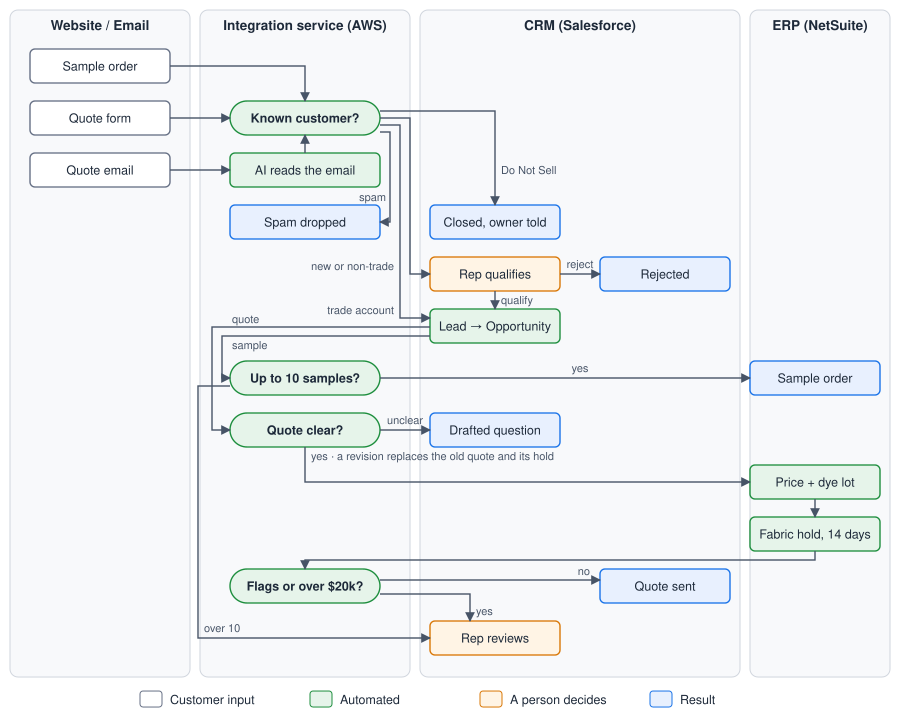

# Sample-to-Quote Integration: Design Note

**Client:** Perennials Fabrics (Bertram Capital) · **Prepared by:** Bennett Davis · **Date:** October 2026 · PDF version: [`design-note.pdf`](design-note.pdf)

## Summary

Perennials' sample-to-quote process spans three systems that do not exchange data: the WooCommerce website, Salesforce (CRM) and NetSuite (ERP). Staff bridge the gaps by hand. They re-enter website submissions into Salesforce, relay sample and hold requests to order operations by email, and correspond with customers while stock and pricing are checked. The proof of concept introduces a single integration layer with two objectives: **no value is entered twice**, and **no customer waits on an internal hand-off**. In the reference scenario, one customer's journey from sample request to quote falls from an estimated 36 manual steps and 86 re-entered values to three decisions by a sales representative.

## 1. Architecture

*Figure 1. Target process. Each step is placed in the system where it runs.*

A single integration service mediates between the three systems. Website orders arrive through a webhook and quote emails through an inbox notification. Every request follows the same sequence: interpret the request, identify the customer, apply business rules, update Salesforce and NetSuite, and route anything uncertain to a sales representative. Two principles shape the design:

- **AI is limited to unstructured input.** Website orders already carry exact product codes and need no interpretation. Claude is used only to turn free-text emails into product codes and quantities. Its output is constrained to a fixed schema, validated against the catalog and cross-checked by a rule-based parser. Qualification, pricing, dye-lot allocation and inventory holds are deterministic, tested code, and customer correspondence is generated from templates populated with ERP data.
- **Systems are accessed through adapters.** The workflow reaches Salesforce and NetSuite only through defined interfaces. The proof of concept implements them as in-memory simulations; production substitutes live integrations with the same interface, and the existing test suite becomes the acceptance criteria.

## 2. Which system is the source of truth for what

| Data | System of record | Notes |
|---|---|---|
| Customers and companies, trade status, Do Not Sell, qualification | Salesforce | NetSuite customer created on first order, keyed to the Salesforce Account ID |
| Opportunities, quotes issued to customers, review tasks | Salesforce | The quote record is what the customer received |
| Items, list prices, pricing rules | NetSuite | Salesforce does not maintain prices of its own |
| Inventory by dye lot, holds, sample, CFA and sales orders | NetSuite | Salesforce displays a read-only reference |
| Original website order or email | Source channel | Retained verbatim on the Salesforce Lead |

## 3. How the PoC would map onto real systems like Salesforce and NetSuite

| Component | Implementation |
|---|---|
| Website intake | WooCommerce order-created webhook. Each colorway is a product variant whose SKU matches a NetSuite item. |
| Email intake | Gmail API notifications for quotes@perennialsfabrics.com. |
| Integration service | Python service on AWS. Duplicate deliveries are processed once, each customer's requests are handled in order, and failures are retried, then held in a dead-letter queue with alerting. |
| Salesforce | Lead conversion, Opportunity and Quote. Review items appear as Tasks with Qualify, Approve and Reject actions that call the service. An approval process covers quotes above $20,000. |
| NetSuite | Pricing script (trade, volume and cutting-fee rules), sample and CFA order forms, lot-level inventory holds, and a daily job that releases expired holds. |
| MCP servers | Salesforce Hosted MCP Servers and the NetSuite AI Connector Service expose Perennials' pricing, inventory and lead-conversion logic as tools for staff-facing AI assistants, under each user's own permissions. The unattended pipeline uses service-authenticated APIs, because both MCP servers require a signed-in user. |

## 4. Where a human should stay in the loop

Routine cases are automated: spam, requests from known trade accounts and quotes without exceptions. Decisions involving judgment or financial exposure remain with people:

- **Qualification of new customers.** Trade status determines complimentary samples and trade pricing, so a representative approves or rejects every new sender. The system offers no recommendation.
- **High-value quotes.** Quotes above $20,000 require manager approval.
- **Inventory exceptions.** Quantities split across dye lots, shortfalls and backorders.
- **Ambiguous requests.** A color the system cannot resolve, more than ten samples, or disagreement between Claude and the rule-based parser.
- **Restricted accounts.** Requests from Do Not Sell accounts are blocked and the account owner is notified.

Every review item includes a drafted customer message, so the representative's next step is a single action rather than an email exchange.

## 5. What I would do next with another week

1. **Run it on live data.** Connect the adapters to Salesforce and NetSuite sandboxes and replay real traffic in a read-only shadow mode, measuring agreement with what the team actually did before anything is written.
2. **Give every rep an AI assistant over MCP.** Connect Claude to the Salesforce Hosted MCP Server and the NetSuite AI Connector Service so sales and order-operations staff can ask, in plain language, "what has this account sampled?", "which dye lot covers 45 yards?" or "draft the follow-up", and resolve review items in seconds, within their own permissions.
3. **Publish Perennials' business rules as shared MCP tools.** Expose pricing, dye-lot allocation and lead conversion as NetSuite custom tools and Salesforce Apex tools, so the automation and every assistant call one implementation and an answer in chat always matches the quote the customer receives.
4. **Close the loop with the customer.** An accept or decline link on each quote converts the hold into a sales order, or releases it, with a reminder before the hold expires.
5. **Prove the return.** An extraction evaluation on about 100 historical emails to set review thresholds from evidence, and a sample-to-quote-to-order conversion dashboard by customer segment to quantify revenue impact.
